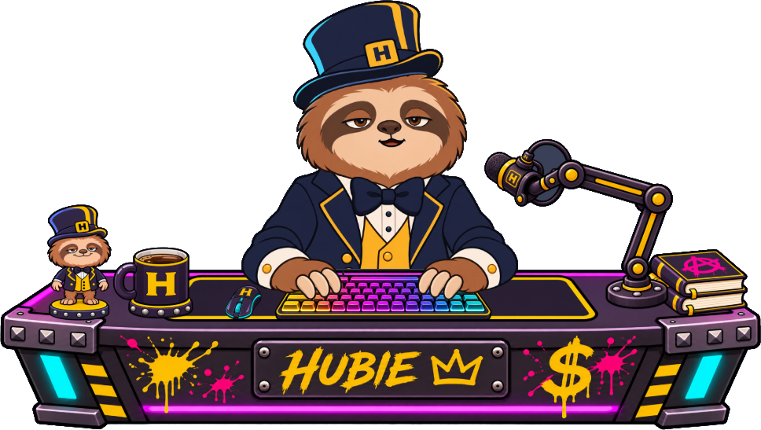
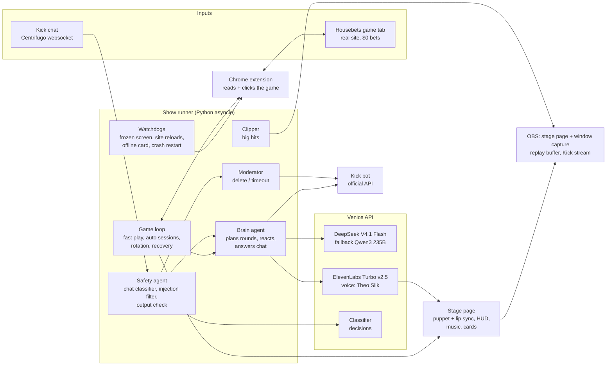

# Hubie Streamer

<p align="center"></p>

Hubie is a dapper sloth in a top hat who streams casino house games on Kick, fully on his own, 24/7.
He plays the real [Housebets](https://www.housebets.com) originals in a Chrome window (every bet is
$0, checked before each click), talks with an AI voice, trash-talks chat, takes votes, and keeps the
show going through site outages without a human touching anything.

**Setup in one page: [SETUP.md](SETUP.md).** Agents and tools diagram: [How it works](#how-it-works).

## What he does

- **Plays real games:** Dice, Limbo, Coin Flip, Wheel, Plinko, Keno, Max Win, Mines, HiLo, Dragon
  Tower and Hubie's Road, on the live site, through a small Chrome extension.
- **Plays like a degen, not a spreadsheet:**
  - **Step games** (Tower, Road, Mines, HiLo): one AI plan per round (difficulty, cash-out target),
    then he climbs without stopping and only talks when the run gets interesting (5x, 10x, 20x...).
  - **One-shot games:** continuous auto sessions with pretend bet sizing that presses on wins.
    Dice at 6x, Limbo at 7x, Plinko in 5-ball bursts on max rows, Keno on ten numbers at a risk he
    picks (mostly high).
  - **Picks his own settings** where a game has them: mine count, difficulty, wheel risk, Max Win mode,
    Keno risk. Chat can overrule the mine count with a vote.
  - **Streak talk scales with the odds:** two 6x wins in a row is a tease, five is the clip of the night.
  - **Commentary never stops play:** lines, chat replies and ads play over the clicks; the next
    round is planned while the current one runs. See [Feeling live](#feeling-live).
- **Talks:** DeepSeek through Venice for the brain, ElevenLabs "Theo Silk" through Venice for the
  voice, with Rhubarb lip sync. He swears (18+ stream), roasts chat back, and mocks balance questions.
- **Reads chat:**
  - **Replies with context:** answers in priority order and remembers each viewer's whole conversation
    (what they said, answered or not, and what he said back), kept across restarts.
  - **Answers first:** a waiting reply jumps ahead of his own filler and game chatter.
  - **Votes:** `!<game>` votes (aliases like `!dragontower` work, and so does "play plinko"),
    `!mines 10` votes, `!skip`/`!next`/`!song` for music.
  - **Takes Mines calls:** "top corners", "middle", "tile 7": he clicks those tiles next.
  - **Thanks new followers** with an on-screen alert.
- **Moderates:** a Kick bot account deletes links, prompt-injection attempts and hate, and times out
  repeat offenders. Strict injection filtering, since it all runs on a home machine.
- **Auto-clips big hits:**
  - **Triggers:** any 500x+ win, a 1,000x Plinko ball, or a new stream record.
  - **Output:** a 16:9 clip and a vertical 9:16 cut (caption, game, Hubie) saved from OBS's replay buffer.
  - **The moment:** he hypes it on air, shows a "Clipped" card, and posts it in chat.
- **Stays up:**
  - **Game failures:** a failing game gets benched and he moves to another.
  - **Site self-reloads:** the move in flight is retried once.
  - **Frozen window:** the page is reloaded.
  - **Downtime:** viewers see a "be right back" card while the site is down.
  - **Crashes:** the runner restarts itself without asking for keys again.
  - **Bad config edits:** rejected while live; at startup he falls back to the last config that worked.
  - **Network drops:** chat, models and the game reconnect and retry on their own.
- **Ad breaks:** about once an hour he throws to a commercial ("we'll be right back after these
  messages"): a video from `assets/ads/` starts on his monitor, grows to full screen and settles
  back, with its sound levelled, the music off and play paused.
- **Fills the room:** NCS drum and bass that ducks under his voice (the tracks are credited on
  screen and with `!song`), timed ads and reminders, game rotation every 25 minutes when chat is
  quiet, and a "no human input" runtime clock.

## How it works



**Agents and tools**

| Agent / tool | Job | Built with |
|---|---|---|
| Brain | plans each round or auto session, writes reactions, answers chat by name with per-viewer memory | DeepSeek V4.1 Flash via Venice (Qwen3 235B fallback), JSON-schema tool calls |
| Safety | scores every chat message (injection, harassment, spam, gambling harm), checks every line before it's voiced | Venice decisions classifier + regex rules |
| Moderator | deletes links, injection attempts and hate; times out repeat offenders | Kick official API (bot account) |
| Voice | voices lines (safety-checked in parallel), caches them, levels loudness; keeps a bank of pre-voiced interjections | ElevenLabs Turbo v2.5 (Theo Silk) via Venice, ffmpeg |
| Puppet | animated Hubie from the official art: lip sync, blinks, expressions, reactions (a signature bow-tie straighten on records, big cash-outs and ad breaks) | Canvas 2D, Rhubarb Lip Sync, face parts and poses made with Venice image edits |
| Player | drives the real games: picks, bets, reads results, fails closed on any non-zero bet | Chrome extension (MV3) over a local websocket |
| Watchdogs | spot a dead or frozen game window, site reloads, offline games; recover without a human | macOS window capture, page reload, game rotation |
| Clipper | saves big hits as 16:9 and vertical 9:16 clips | OBS websocket + replay buffer, ffmpeg, Pillow |

## Feeling live

A written-and-voiced line takes 3 to 7 seconds (about 1.5 s to write, 2 to 5 s to voice). A human
reacts in under one. Hubie hides the gap the way a video app shows a poster frame while the stream
buffers:

- **Instant interjections:** when a big moment lands (a hit, a hot streak, a deep run, a painful
  bust) he blurts a pre-voiced line from a bank ("Oh, look at that!", "Steady, sloth. Steady.") at
  once. The real line is written in parallel, told what he just blurted, and follows on from it. One
  blurt per 45 s at most, never one of the last six, so they stay a reaction and not a tic.
- **Lines written before they're needed:** in auto sessions, when one more win would make a streak
  worth talking about, that line is written while the bet is still in the air (and voiced ahead for
  the rare tiers), so it plays right on the hit.
- **Play never waits on talk:** step games plan the next round during the current one, run lines
  play over the next clicks (a line that's stale by the time it's ready is dropped for the result),
  and the safety check runs alongside the voice render instead of before it.
- **Viewers never wait behind the show:** chat replies have their own slot, so a reply waits only
  for the line being spoken, not for a queue of game commentary.
- **Switching games:** the next game loads while he announces it (a switch went from 21-30 s of dead
  air to about 7 s).
- **Measured, not guessed:** the runner logs every gap over 3 s where nothing moved in the game
  (`timing: game idle ...`) and each line's write and voice time.

On Mines this took dead air from 7 to 22 s every round to a few gaps of about 4 s in five minutes.

We also timed other voices on Venice against the current one (same eight lines). ElevenLabs Theo
Silk was fastest at 3.8 s a clip; MiniMax Speech-02 HD took about 5 s, Gemini 3.1 Flash TTS about
7 s and Qwen3 TTS 26 s or more.

## Requirements

- macOS (window capture and the screen watchdog use macOS APIs), Python 3.13 with
  [uv](https://docs.astral.sh/uv/), ffmpeg, Google Chrome, OBS 28+.
- A [Venice](https://venice.ai) API key (LLM, TTS, safety classifier), or another provider (see below).
- [Rhubarb Lip Sync](https://github.com/DanielSWolf/rhubarb-lip-sync) in `tools/` for lip sync (optional:
  without it the mouth follows loudness).
- Optional: a Kick app (client id/secret) and a bot account for chat replies and moderation; an
  OBS websocket password for auto-clips.

| Environment variable | Needed for |
|---|---|
| `VENICE_API_KEY` | the brain, voice and safety checks |
| `KICK_CLIENT_ID`, `KICK_CLIENT_SECRET` | the Kick bot (chat posts, moderation) |
| `OBS_WS_PASSWORD` | auto-clips |

**Not tied to Venice.** I built this on Venice because I work there and Venice is awesome! Hubie
doesn't need it, though. The brain and the voice use the standard OpenAI-style endpoints (`/chat/completions`
in `showrunner/brain.py`, `/audio/speech` in `puppet/tts.py`), so any OpenAI-compatible provider
works: point the `API` constant in each file at its endpoint, put its key in `VENICE_API_KEY` (only the
name is Venice's), and set its model ids in `config.toml` `[models]` and its voice in `tts.py`. The one Venice-specific piece is the safety classifier
(`showrunner/safety.py`, Venice's `/decisions` endpoint). Its regex rules for injection and abuse
work anywhere; the model-scored check would need another moderation API or an LLM call in its place.

## Run

```sh
export VENICE_API_KEY=...            # or let run.sh read it from 1Password (`op`)
./showrunner/run.sh --chat kick --kick-channel <your channel id>   # no args = simulated chat
```

- `run.sh` restarts the show if it crashes, reusing the keys it already read.
- `--paused --chat none` connects everything but stays idle, for working on game plugins.
- **Admin API:** `POST http://127.0.0.1:8000/admin/<cmd>` with `X-Admin-Token: $(cat showrunner/.admin_token)`.
  - **Commands:** `status`, `pause`, `resume`, `say`, `game`, `reload`, `chat`, `bridge` and `act`.
  - **Most commands count as human input,** which restarts the on-screen "no human input" clock.
  - **Maintenance commands don't:** bridge `query`, `status`, `stream_mode` and `reload_extension`.
- **Kick bot sign-in:** one time, open `http://localhost:8000/kick/login` in a browser logged in as the bot account.

## Chrome setup (one time)

1. **Load the extension:** go to `chrome://extensions`, turn on Developer mode, click "Load
   unpacked" and pick `extension/`.
   - **Use your main profile.** Fresh profiles may be blocked by Cloudflare.
   - **What it does:** it opens the Housebets stream window by itself and reconnects on its own.
2. **Start Chrome with `--disable-backgrounding-occluded-windows`.** A small launcher app works well.
   - **Why:** Chrome pauses windows you can't see, and Housebets games wait on their animations, so
     a covered window would freeze Hubie mid-round.
   - **Where it has to go:** it's a command-line switch, not a `chrome://flags` setting. Check it in
     `chrome://version`.
3. **Keep the site active:** in `chrome://settings/performance`, add `housebets.com` to "Always keep
   these sites active".
4. **Don't open Housebets in another tab of the same profile while streaming.** The tabs can fight
   over the game session.

## OBS

Sources, top to bottom:

1. **Browser:** `http://127.0.0.1:8000/stage/live.html?part=over`, 1920×1080, with "Control audio
   via OBS" on. This is the bezel, chat, Hubie, HUD, the cards and the music, and it carries his voice.
2. **macOS Screen Capture, Window:** the "… in House Games | Housebets" window. Crop the title bar,
   then place it at 880,87 with an 843×501 bounding box.
3. **Browser:** `http://127.0.0.1:8000/stage/live.html?part=under`, 1920×1080. This is the room and the back of the monitor.

For auto-clips:
- **Settings → Output → Replay Buffer:** on, 60 s.
- **Tools → WebSocket Server Settings:** on, port 4455, with a password. Pass it as `OBS_WS_PASSWORD`.
- **Where clips land:** `~/Movies/Hubie Clips/`.

After changing scene or HUD files, select the browser source and click **Refresh**.

## Games and chat commands

| Chat | Does |
|---|---|
| `!tower` `!road` `!plinko` `!limbo` `!flip` `!wheel` `!hilo` `!maxwin` `!mines` `!dice` `!keno` | vote for the next game (60 s poll) |
| `!mines 1-24` | open a 20 s vote on the mine count; the winner holds for 3 minutes |
| "top corners", "middle", "bottom left", "tile 7" | during Mines: Hubie clicks those tiles next, in the order named |
| `!song` / `!track`, `!next`, `!skip` | current track (NCS credit), up next, vote to skip |
| `!commands`, `!record`, `!uptime`, `!rules` | the basics |
| "play plinko", "get on those mines" | counts as a vote for that game |
| say "Hubie" | he answers (he remembers each viewer's conversation, across restarts) |

When Housebets changed how Dice takes input mid-contest (its boxes now show whatever is typed even when
the game ignores it), a fresh browser couldn't get past Cloudflare to debug it. So Dice reads the game's
real roll target from its slider, steps the slider with arrow keys, and rejects any result that doesn't
fit the odds it thinks it's playing (Limbo checks its results the same way). A game that fails saves a
page snapshot and is benched for a few minutes, then retried.

## Configuration

`showrunner/config.toml` is re-read live, even mid-session. A bad edit is rejected and logged, and a
bad file at startup falls back to the last good one (`.config.last-good.toml`). It covers:
- **Models and voice:** model fallbacks, voice speed.
- **Pacing:** `fast_play`, `talk_from_x`, game rotation, chat reply rate.
- **Safety and persona:** safety thresholds and the persona prompt (his voice, trash-talk rules, hard lines).
- **Chat:** bot commands, catchphrases, and the instant interjection bank (`[interjections]`).
- **Segments:** timed ads and reminders.
- **Ad breaks (`[ad_break]`):** interval, intro and outro lines, and per-video placement (`zoom`,
  `monitor` or `full`). Videos go in `assets/ads/` and are levelled to -18 LUFS on first play.
- **Music:** volume, ducking and skip votes.

## Music

No music ships with the repo. `tools/ncs_fetch.py` downloads [NoCopyrightSounds](https://ncs.io)
tracks, which are free to stream with credit, into `assets/music/`, with their track pages recorded so
the HUD and `!song` can credit each one.

## Stack

- **Models:** DeepSeek V4.1 Flash (primary) and Qwen3 235B Instruct (fallback) for the brain; Venice's
  decisions classifier for safety; all through the [Venice API](https://venice.ai).
- **Voice:** ElevenLabs Turbo v2.5, voice "Theo Silk", through Venice.
- **Animation:** our own Canvas 2D puppet; [Rhubarb Lip Sync](https://github.com/DanielSWolf/rhubarb-lip-sync)
  for mouth shapes; face parts and poses generated from the official Hubie art with Venice image edits
  (Flux) and cut into layers with Nettie, my own puppet-building tool, kept as a separate private
  project; this repo keeps only the finished layers.
- **Streaming:** OBS (browser sources + window capture, replay buffer) to Kick; Kick official API for the bot.
- **Plumbing:** Python 3.13 (asyncio, websockets, httpx), a Chrome MV3 extension, ffmpeg, pyobjc (Quartz).
- **Music:** NoCopyrightSounds (credited on stream).
- **Templates or kits:** none; everything here was written for this project.

## Staying safe on air

| Rule | How |
|---|---|
| Demo play only, no real money | every bet is $0, checked right before each click; a non-zero amount stops the game |
| 18+ and gamble responsibly on screen | a permanent "18+ · Gamble responsibly · Demo play, $0 bets" badge under the game monitor, plus a spoken reminder every 15 min |
| Never promises wins or pushes deposits | the persona forbids it; every line passes an output check that blocks guaranteed-win talk and pushing real-money play |
| Moderates chat | the safety agent screens every message; the bot deletes links, injection attempts and hate, and times out repeat offenders |
| Prompt injection | regex rules plus a separate "steering" score; chat is always passed to the model as quoted viewer content, never as instructions |

## Notes

- **Bets:** every bet is $0. Each game checks the bet amount right before clicking and fails closed.
  This is entertainment, not gambling advice, and the stream is 18+.
- **License:** all rights reserved; shared as a Housebets contest entry (see `LICENSE`).
- **Secrets:** API keys come from the environment (or 1Password via `op`) and are never written to disk.
  Kick bot tokens live in `showrunner/.kick_tokens.json` (gitignored, mode 600).
- **Viewer data:** each viewer's chat with Hubie is kept in `showrunner/.viewers.json` on the streaming
  machine only (gitignored, last 30 lines per viewer, longest-quiet viewers dropped past 300).
- **AI assets:** the desk scene, face parts and poses were generated with Venice image models
  from the official Hubie art. The generation and cutting pipeline is Nettie, a separate
  project of mine (not a third-party tool); only its output, `assets/desk/layers/`, ships here.
- **Videos:** the demo clips and the ad are made in hubie-studio, another separate project of mine, which plays
  scripted scenes on this repo's puppet and room art and records them.
